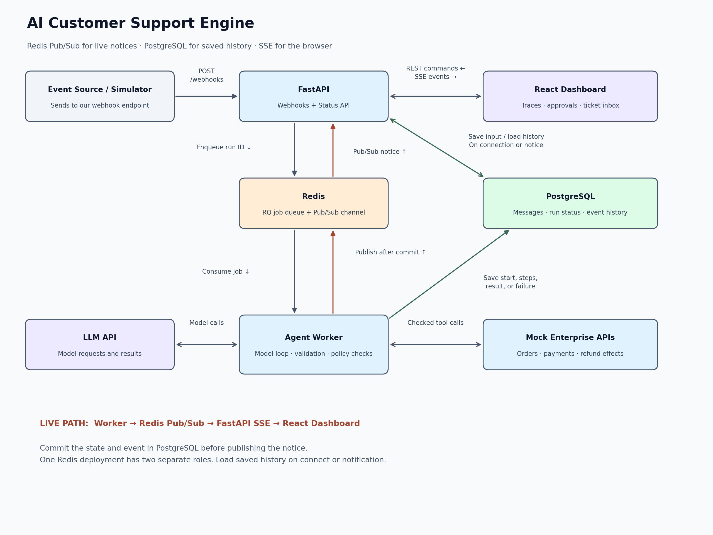
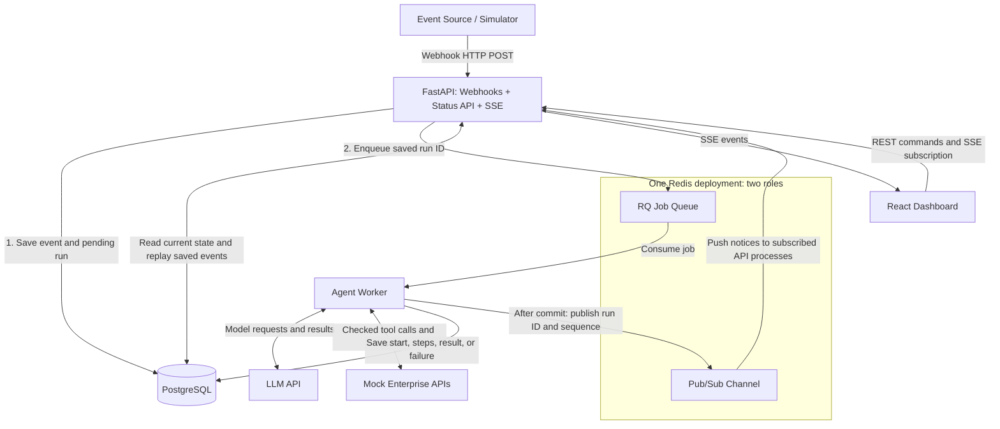
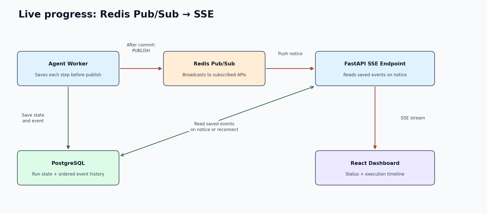

# Event-Driven AI Customer Support Engine

Status: proposed design · Version: 0.4 · Updated: 7 November 2026

## 1. Purpose

Build a customer support engine for a simulated commerce company. Use the project to prepare for software engineering and AI agent engineering roles.

Start with the main components. Add reliability mechanisms after the basic request path is clear.

The first release answers order questions and handles approved mock refunds. All customer data and financial actions are synthetic.

The Docker starter implements saved order inquiries and Pub/Sub-to-SSE updates. Refunds, real model calls, and the React operator dashboard remain planned.

See [implementation status](implementation-status.md) for tested scope. The HTML explorer still shows proposed behavior.

### Writing method

Use short sentences, active voice, and one topic per paragraph. Define technical terms and use one name for each component.

This document applies [ASD-STE100 writing principles](https://www.asd-ste100.org/STE_faq.html). A complete rules and dictionary review remains open.

### Terms

| Term | Meaning |
| --- | --- |
| Event | A record of something that happened. |
| Job | A request for a worker to execute work. |
| Run | The saved record of one agent execution, including later attempts. |
| Commit | Complete a database transaction and save its changes. |
| Pending | Saved work that has not started execution. Queue submission can still be unconfirmed. |
| Tool | A named function that reads data or requests an action. |
| Policy | Rules that determine whether an action is permitted. |
| Tenant | A company whose records must remain separate from other companies' records. |
| Checkpoint | Saved progress from which a run can continue. |
| Idempotency key | A stable identifier that prevents repeated requests from repeating the same business effect. |
| Pub/Sub | Publishers send notices to a channel. Connected subscribers receive those notices. |
| SSE | Server-Sent Events. An HTTP stream from the API to the browser. |
| Trace | Linked records that describe a request's progress and timing. |
| Outbox | An optional database table of requests to publish jobs. |

## 2. Scope

### Initial version

- Accept signed customer webhooks.
- Save customer messages and pending runs in PostgreSQL.
- Submit saved run IDs directly to Redis/RQ.
- Execute jobs in an agent worker.
- Call a model and mock enterprise APIs.
- Check tool arguments, permissions, and refund policy inside the worker.
- Require human approval for each refund.
- Save progress, results, and failures.
- Publish a Redis notice after each saved progress update.
- Stream saved events through FastAPI SSE to the React dashboard.
- Provide an authorized retry operation for incomplete work.

Use one model provider through an adapter. Provide a fake model for repeatable tests without paid credentials.

### Later reliability work

Automatic recovery, a transactional outbox, and a dispatcher are later options. The initial design has no separate Tool Gateway component.

Keep tenant-aware data and two seeded tenants. Validate access before every data read and external action.

Real payments, real customer channels, multiple agents, Kubernetes, and a separate durable streaming platform remain outside the initial scope.

## 3. Main components



[Open the diagram](diagrams/architecture.png) · [Open the vector diagram](diagrams/architecture.svg)

<details>
<summary>Editable Mermaid source</summary>



</details>

| Component | Responsibility |
| --- | --- |
| Event Source / Simulator | Send customer events to our endpoint. The simulator also records mock responses. |
| FastAPI | Accept webhooks. Save events. Enqueue runs. Serve status, commands, and SSE. |
| PostgreSQL | Store messages, run state, progress events, approvals, and results. |
| Redis | Hold RQ jobs and carry Pub/Sub notices through separate interfaces. |
| Agent Worker | Check tool requests. Commit progress. Publish a Redis notice after each commit. |
| LLM API | Propose tool calls and customer responses. |
| Mock Enterprise APIs | Simulate scoped order and payment operations. |
| React Dashboard | Display status and event history. Collect operator decisions. |

FastAPI is one service with several endpoints. The webhook endpoint receives customer events. Separate endpoints serve status and dashboard subscriptions.

Redis has two roles in one deployment. RQ schedules jobs for workers. Pub/Sub broadcasts progress notices to connected FastAPI processes.

The overview groups these Redis roles in one box. The Mermaid source separates the two roles inside one Redis boundary.

### Who owns the webhook connection?

We own the receiving FastAPI endpoint, such as `POST /webhooks/support`. The event source sends an HTTP request to that endpoint.

The source can be an external support platform or a customer's backend. If we build the source application, we can own both sides.

In production, configure our receiving URL in the source system. The simulator replaces that source during local development.

The end customer usually sends a message through a channel. The channel's platform then sends the webhook to our receiver.

For this HTTP request, the sender is the HTTP client. Our FastAPI application is the HTTP server.

See [GitHub's webhook explanation](https://docs.github.com/en/webhooks/about-webhooks) for an example of this sender-and-receiver arrangement.

The worker contains argument validation, access checks, policy checks, and tool execution. These responsibilities do not need another box or HTTP service.

Mock APIs own their enterprise data. The dashboard and worker must use the permitted API paths to access that data.

## 4. Webhook acceptance: save first, then enqueue

Use this sequence for a new event:

1. Verify the signature and timestamp.
2. Derive tenant and customer identity from the trusted integration.
3. Start a PostgreSQL transaction.
4. Save the inbound event and customer message.
5. Create a run with status `pending`.
6. Append a `run.received` event.
7. Commit the transaction.
8. Enqueue a job that contains the saved `run_id`.
9. Record queue submission information without changing a newer run state.
10. Return `202 Accepted` after queue submission succeeds.

The job contains an identifier. The worker loads the message and trusted context from PostgreSQL.

Save first so that a fast worker can always find its run. Do not keep the database transaction open during the Redis request.

### Where the transaction ends

The PostgreSQL transaction contains only PostgreSQL writes. The Redis enqueue happens after the commit, as a separate operation.

```text
PostgreSQL transaction starts
    save event, message, pending run, and receipt event
PostgreSQL transaction commits

Redis operation starts
    enqueue the saved run ID
```

Both operations occur during one webhook HTTP request. That does not make them one atomic transaction.

A database rollback cannot undo an already submitted Redis job. A later Redis failure cannot undo the committed PostgreSQL records.

A worker can start before the API records queue submission. An API update must not replace `running` or `completed` with `pending`.

Use separate `enqueued_at` and submission-error fields. The worker owns execution-state changes.

### If a step fails

| Failure | Behavior |
| --- | --- |
| Database commit fails | Do not enqueue. Return a retryable error when appropriate. |
| Redis submission fails | Keep the pending run. Return a retryable response with its ID. |
| Process crashes after commit but before enqueue | The run remains pending. A sender retry or operator retry must resubmit it. |
| Queue reply is lost | Submission is uncertain. Retry the same run ID and tolerate duplicate jobs. |
| Redis loses a queued job | The saved run remains. The initial version needs a retry to restore execution. |
| Queue submission succeeds | Return `202`. This means scheduled, not completed. |

The database and queue writes are separate. The initial version does not guarantee automatic recovery between them.

This failure gap motivates the [transactional outbox pattern](https://microservices.io/patterns/data/transactional-outbox.html). The pattern is a later improvement, not an initial component.

### Duplicate webhooks

Use a unique constraint on tenant, source, and external event ID. Save a payload hash to detect changed content under the same ID.

An exact duplicate returns the same saved event and run. If that run remains pending, a retry can submit its existing run ID again.

Do not create another message or logical run for the same external event. Return `409 Conflict` if the ID has different content.

## 5. Job execution: save start, progress, and outcome

The worker reads its run from PostgreSQL. It checks execution ownership before it calls the model or a tool.

Use short transactions at each state change. Save the current state and its related history event in the same transaction.

After commit, publish a small notice through Redis Pub/Sub. Publish only references to saved events, not uncommitted state or customer content.

| Stage | Current run record | History event or saved result |
| --- | --- | --- |
| Webhook accepted | `pending`, event ID, message ID, receipt time | `run.received` |
| Worker starts | `running`, attempt ID, start time, ownership | `run.started` |
| Model request | Usage and progress metadata | `model.requested`, then `model.completed` |
| Tool request | Saved action ID and arguments hash | `tool.requested` |
| Tool completes | Redacted result and checkpoint | `tool.completed` |
| Approval required | `waiting_approval`, exact proposal | `approval.requested` |
| Temporary error | `retry_pending`, error and retry count | `run.retry_scheduled` |
| Successful result | `completed`, response, finish time, usage | `run.completed` |
| Human handling required | `escalated`, reason | `run.escalated` |
| Unrecoverable error | `failed`, error category, finish time | `run.failed` |

A model or API request happens outside the database transaction. Do not leave a transaction open during network calls.

Save a write action before calling the mock API. Use its existing idempotency key after a timeout or retry.

If the worker crashes, saved state can still show `running`. A retry must check expired ownership before another worker continues.

An error handler cannot always record a process crash. Automatic detection of stale runs belongs to the later recovery milestone.

### Tool checks inside the worker

Before each tool call, check these conditions:

- The tool name is permitted.
- The arguments match the schema.
- The customer owns the requested order.
- The request belongs to the correct tenant.
- Current business policy permits the action.
- A refund has valid approval for the exact payment, amount, and currency.

The worker supplies credentials and verified identity. Model output cannot grant permission or approve a refund.

### Response delivery

Completion means the agent produced and saved an outcome. Delivery means the customer channel received the response.

Save the response and a pending delivery record together. Submit a delivery job directly to RQ after commit.

A failed submission leaves a retryable delivery record. The same scheduling gap applies to deliveries and approval continuations.

The simulator records delivery confirmation. The dashboard shows delivery state separately from agent completion.

## 6. Dashboard updates: Redis Pub/Sub and SSE



The worker saves progress before it publishes a notice. FastAPI receives the notice through a Redis subscription and sends saved events through SSE.

```text
Agent Worker ──commit state and run events──→ PostgreSQL
     │
     └──after commit: PUBLISH──→ Redis Pub/Sub
                                      │
                                      └──push notice──→ FastAPI
                                                          │
                                 read saved events ←───────┤
                                                          └──SSE──→ React
```

The normal live path uses no repeated status query or database polling. FastAPI waits for notices on its Redis connection.

PostgreSQL remains the durable history. Redis Pub/Sub supplies live delivery signals. SSE carries the event stream from FastAPI to React.

### Publish after commit

Use this sequence for each worker step:

1. Save the state change and its `run_events` row in one PostgreSQL transaction.
2. Commit that transaction.
3. Publish the saved run ID and sequence through Redis.
4. FastAPI receives the notice and checks its subscribed run.
5. FastAPI reads saved events after the browser's last sequence.
6. FastAPI streams those events in sequence order through SSE.

The API also publishes notices for events it creates, such as `run.received` and approval decisions. Delivery workers publish after saving delivery results.

Use one shared save-and-publish convention for these producers. A dashboard update must never depend on another incoming webhook.

### Channel and notice contract

Use a server-selected channel such as `support:dev:tenant:tenant_17:run-events`. Include the deployment environment and verified tenant ID.

```json
{
  "schema_version": 1,
  "tenant_id": "tenant_17",
  "run_id": "run_42",
  "event_id": "event_13",
  "sequence": 13
}
```

Keep customer messages, tool arguments, and secrets outside the notice. Load permitted, redacted event details from PostgreSQL before browser delivery.

The notice identifies progress. It is not the saved event history or a task for an RQ worker.

### FastAPI subscription and local delivery

Each FastAPI process subscribes to channels needed by its connected dashboards. Wait for Redis to confirm a new subscription before the initial replay.

Use a Pub/Sub connection separate from RQ commands. One process can share its subscription across local browser connections.

Redis broadcasts to each subscribed API process. Each process forwards matching updates to its own authorized browser connections.

Derive tenant and channel access on the server. The browser must not choose arbitrary Redis channels or connect directly to Redis.

Keep a bounded notification buffer for each active run. Release database connections after short replay queries.

### First connection and replay

The browser can request `GET /runs/{run_id}` for a current snapshot. It opens `GET /runs/{run_id}/events` for history and live events.

Use this subscription sequence:

1. Authenticate the browser and check run access.
2. Attach a bounded local notification buffer.
3. Confirm the Redis subscription.
4. Read saved events after `Last-Event-ID`, or after zero for a new timeline.
5. Send those records in sequence order.
6. Handle buffered notices and read any remaining saved events.
7. Wait for subsequent Redis notices and repeat the event read when notified.

Subscribe before replay so that a commit during replay cannot disappear between those operations. Use the per-browser sequence cursor to suppress duplicates.

A notice for sequence 15 can trigger replay of events 13 through 15. Read every missing saved row, not only the row named by that notice.

The `runs` table stores current status. The `run_events` table stores the ordered history.

| Sequence | Saved event | Dashboard display |
| --- | --- | --- |
| 1 | `run.received` | Message saved; execution pending. |
| 2 | `run.started` | Worker started attempt 1. |
| 3 | `model.requested` | Model request started. |
| 4 | `tool.requested` | Agent requested `get_order`. |
| 5 | `tool.completed` | Order lookup completed. |
| 6 | `run.completed` | Response saved. |
| 7 | `response.delivered` | Simulator received the response. |

This is an abbreviated example. Save other events, such as model completion, when they occur.

Each row includes `run_id`, `event_id`, `sequence`, `attempt_id`, `type`, `occurred_at`, and redacted details.

Allocate sequences atomically within a run. Retain the run ID across retries and use a new attempt ID.

Do not store private model chain-of-thought. Record observable requests, results, and brief decision summaries.

### Disconnects and delivery limits

Redis Pub/Sub uses at-most-once delivery. A disconnected subscriber cannot replay a notice from the channel. See [Redis Pub/Sub](https://redis.io/docs/latest/develop/pubsub/).

Use saved PostgreSQL events to recover after a browser or Redis subscription reconnect. Re-establish the subscription before the catch-up read.

If the API loses Redis access, close affected SSE streams after bounded reconnection attempts. Browser reconnection then triggers saved-event replay.

Disconnect slow browsers before local buffers grow without limit. Replay from their last event sequence when they reconnect.

Send SSE heartbeat comments without querying PostgreSQL. Heartbeats maintain the connection; they do not replace missing-event recovery.

### Database commit and publish failure

The PostgreSQL commit and Redis `PUBLISH` are separate operations. They do not form one atomic transaction.

If commit fails, publish nothing. If publication fails, retain the saved progress and record the publication error.

Retry publication within a small limit without repeating the model call or business action. A zero subscriber count does not undo the saved event.

A crash after commit can prevent publication. A later notice or reconnect can recover the saved event.

If no later notice arrives, a connected dashboard can remain stale until refresh or reconnect. The initial design accepts this limitation.

Add reliable publication through an outbox or another durable mechanism before promising automatic delivery of every saved update. That improvement remains outside the initial diagram.

### SSE behavior

Use the run sequence as the SSE event ID. Preserve that cursor across reconnects and read later PostgreSQL rows.

Apply older snapshots only if their sequence is newer than the displayed state. A delayed snapshot must not replace a newer streamed state.

Protect subscriptions with tenant authorization. Use secure cookies or authenticated streaming fetch, and keep bearer tokens out of query strings.

See [MDN SSE documentation](https://developer.mozilla.org/en-US/docs/Web/API/Server-sent_events/Using_server-sent_events) for browser stream behavior.

## 7. API contracts

### Customer webhook

`POST /webhooks/support`

Headers: `X-Webhook-Key-Id`, `X-Webhook-Timestamp`, `X-Webhook-Signature`.

```json
{
  "schema_version": 1,
  "event_id": "evt_demo_001",
  "event_type": "support.message_received",
  "occurred_at": "2026-11-07T12:00:00Z",
  "source": "simulator",
  "conversation_id": "conversation_42",
  "customer_id": "customer_17",
  "message": { "text": "Where is order ORD-1001?" }
}
```

Check the HMAC against the raw bytes. Apply a timestamp window and message-size limit.

Only an authorized integration can assert customer identity. Derive tenant identity from its verified credential.

### Operator endpoints

| Endpoint | Purpose |
| --- | --- |
| `GET /tickets` | List authorized tenant tickets with cursor pagination. |
| `GET /tickets/{ticket_id}` | Read the conversation and its runs. |
| `GET /runs/{run_id}` | Read current state, outcome, usage, and latest event sequence. |
| `GET /runs/{run_id}/events` | Replay and stream saved events through SSE. |
| `POST /runs/{run_id}/retry` | Resubmit incomplete work after state and ownership checks. |
| `POST /approvals/{approval_id}/decision` | Save an exact approval decision and schedule continuation. |
| `GET /health/live` | Check process liveness. |
| `GET /health/ready` | Check the dependencies necessary for that process. |

Check operator roles on the server. Record approval and retry decisions.

Use idempotency keys and version checks for operator changes. Protect cookie-authenticated changes against CSRF.

## 8. Agent runtime

A normal RQ worker calls a synchronous job function. That function starts the async runtime with `asyncio.run(...)`.

Create and close async clients inside the execution. Add worker processes to increase job concurrency.

A normal RQ worker executes one job at a time. See [RQ workers](https://python-rq.org/docs/workers/).

The agent loop uses this sequence:

1. Load the saved run, message, and verified identity.
2. Obtain execution ownership and save `run.started`.
3. Build context within the configured limits.
4. Save a model-request event and call the model.
5. Check the returned schema and proposed action.
6. Apply tool checks inside the worker.
7. Execute or reconcile the permitted tool call.
8. Save its result and checkpoint, then publish a Redis progress notice after commit.
9. Repeat until a response, approval pause, escalation, or limit.
10. Save the final state and event together.

Initial limits are 8 model turns, 12 tool calls, and 90 seconds per active attempt. Set read-tool timeouts to 15 seconds.

Configure token and cost limits before live-model evaluation. Reserve time to save progress before the execution deadline.

An approval wait releases the worker. After approval, save the decision and pending continuation before submitting the same run ID again.

Use one active execution per ticket. Preserve message receipt order and defer jobs whose earlier ticket work is incomplete.

Check for new cancellation messages before authorizing a write. A request already sent to an external service may need reconciliation or reversal.

## 9. Data model

| Table | Main purpose |
| --- | --- |
| `tenants` | Integration credentials and policy version. |
| `inbound_events` | Original event identity, payload hash, and receipt time. |
| `tickets` / `messages` | Conversation, customer association, and ordered messages. |
| `runs` | Current state, message reference, attempts, ownership, timestamps, outcome, and usage. |
| `run_events` | Ordered, redacted execution history. |
| `tool_executions` | Saved logical actions, arguments hashes, provider keys, and results. |
| `approvals` | Exact proposed action, decision, operator, and expiry. |
| `deliveries` | Saved response, channel, delivery key, state, and attempts. |
| `evaluation_results` | Scenario versions, assertions, scores, latency, and usage. |

The initial schema has no outbox table. Add one only if the later scheduling design uses it.

Use unique constraints for inbound event identity and logical action identity. Index run events by `(run_id, sequence)`.

Use short transactions for current-state and history updates. Use JSONB for versioned event details and checkpoints.

Apply tenant checks in queries and relationship constraints. Add row-level security before a claim of tenant isolation.

A run uses `pending`, `running`, `waiting_approval`, `retry_pending`, `completed`, `escalated`, or `failed`.

Ticket status and response delivery status are separate from run status.

## 10. Recovery and later scheduling options

### Initial recovery

Use saved run state to inspect incomplete execution. An authorized operator can resubmit pending or failed work.

For a stale running attempt, confirm that its execution lease has expired. Prevent the old worker from saving state after a new owner takes over.

Repeat the existing run or action identity. Do not create a new refund identity just because a request timed out.

A mock API must return the original result for matching idempotency keys. Reject changed arguments under the same key.

Coordinate retry limits across model calls, tools, and jobs. Use capped delays and random variation for temporary errors.

The initial version does not detect every crash automatically. Show pending work, stale ownership, and last progress time for operator inspection.

### Later option A: scan pending records

A periodic recovery process can find old pending runs and resubmit them. It must also handle lost queue jobs and expired execution ownership.

This still introduces a background scheduling responsibility. It is not equivalent to an atomic PostgreSQL and Redis write.

### Later option B: transactional outbox

Save application changes and an outbox row in one PostgreSQL transaction. A dispatcher publishes committed rows to RQ.

Use this option for automatic, recoverable publication of runs, continuations, and deliveries. Repeated publication remains possible, so workers still need state and idempotency checks.

Neither option belongs in the initial component diagram. Select and implement automatic recovery before claiming production-grade delivery guarantees.

## 11. Security and evaluation

Keep credentials and complete payment details outside model prompts and traces. Treat model output, customer text, and tool results as untrusted input.

Restrict tools to configured services. Do not accept arbitrary URLs, shell commands, tenant IDs, or approval flags from the model.

Escape customer text and tool results before display. Keep tenant checks on REST routes, tools, and SSE subscriptions.

Use fake-model tests for repeatable execution and failure scenarios. Use a separate live-model suite with 30–50 labeled scenarios.

Check customer ownership, approval, amounts, evidence, and external effects deterministically. Score response quality separately from those assertions.

Test database failures, queue failures, duplicate submission, worker crashes, lost Pub/Sub notices, and SSE reconnection. Verify that operator retry reuses existing run and action identities.

Record model, prompt, tool-schema, policy, and dataset versions. Publish measured success, failures, latency, usage, and sample size.

Proposed performance targets are p95 webhook acceptance below 300 ms and active order resolution below 30 seconds. These targets require measurement.

Target dashboard updates within one second with healthy publication and connected subscribers. Report queue wait, active execution, approval wait, and delivery delay separately.

## 12. Build milestones

| Milestone | Deliverable | Completion check |
| --- | --- | --- |
| 1. Saved job lifecycle | Webhook → PostgreSQL → RQ → fake worker → PostgreSQL. | Save received, started, and completed events. Retry a failed enqueue without another logical run. |
| 2. Tool-using agent | Model adapter, bounded loop, and checked order/payment tools. | Answers use observed records. Invalid or unauthorized calls fail. |
| 3. Controlled refunds | Exact approval, continuation, and idempotent mock writes. | Repeated attempts produce one logical refund. |
| 4. Operator dashboard | Redis Pub/Sub subscription, saved timeline, SSE, and approval controls. | Subscribe before replay. Recover missed notices after reconnect. |
| 5. Recovery and evaluation | Selected automatic scheduling recovery, fault tests, metrics, and labeled scenarios. | Test crashes between database and queue writes. Publish measured results. |
| 6. Portfolio release | Reproducible setup, demonstration, design decisions, and benchmarks. | A reviewer can run normal and failure scenarios. |

Use Docker Compose for the API, worker, dashboard, mock APIs, PostgreSQL, and Redis. A dispatcher or recovery process can be added at milestone 5.

Use FastAPI, Pydantic, SQLAlchemy/Alembic, HTTPX, and Redis/RQ for the Python services. Use React and TypeScript for the dashboard.

Pin versions when implementation starts. Keep the fake-model demonstration usable without paid credentials.

Define the exact mock refund policy before milestone 3. Select a model provider and benchmark hardware before live-model evaluation.
